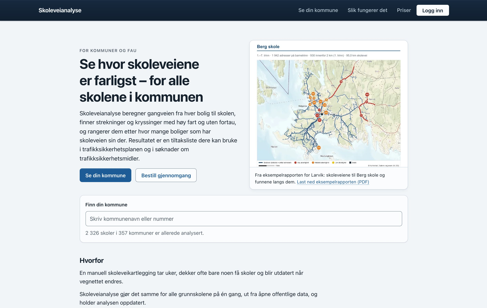

# Jonas Wiger

Bygger for det meste nettjenester på norske åpne data :)

## Smilefjeskartet

**[smilefjeskartet.no](https://smilefjeskartet.no)** viser alle Mattilsynets smilefjestilsyn på ett kart. Over 45 000 tilsyn hos rundt 8 700 serveringssteder, med historikk for hvert sted, statistikk for kommuner, fylker og kjeder, og to modeller som anslår hvem som får tilsyn neste gang og hvordan det går. Nye data hentes hver morgen.

Next.js · TypeScript · MapLibre GL · Vitest · Playwright · [kildekode](https://github.com/JonasW04/smilefjeskart)

## Skoleveianalyse

**[skoleveier.no](https://skoleveier.no)** finner de farligste delene av skoleveiene til alle 2 326 grunnskoler i Norge. Motoren beregner gangveien fra hver bolig til skolen med data fra NVDB, Nasjonalt skoleregister og Kartverket, finner strekninger og kryssinger med høy fart og uten fortau, og rangerer dem etter hvor mange boliger som har skoleveien sin der. Kommunene får tiltaksliste, kart per skole og rapporter i PDF og Excel.

Python · FastAPI · PostGIS · React · MapLibre GL · Docker · kildekoden er privat

## Andre prosjekter

- **[country-fare-finder](https://github.com/JonasW04/country-fare-finder).** Du oppgir flyplassen du reiser fra, et land og en periode, og appen finner de billigste kombinasjonene av byer å fly inn til og ut fra.
- **[Matte3](https://github.com/JonasW04/Matte3).** Øvingsplattform for TMA4422 Matematikk 3C ved NTNU, med gamle eksamensoppgaver sortert etter tema, adaptiv øving og eksamensmodus.
- **[Personlig-Coach](https://github.com/JonasW04/Personlig-Coach).** AI-treningscoach som henter data fra Strava, Hevy og Withings.
- **[TogaBot](https://github.com/JonasW04/TogaBot).** Bot som skaffer billetter til toga og andre arrangementer på Samfundet.
