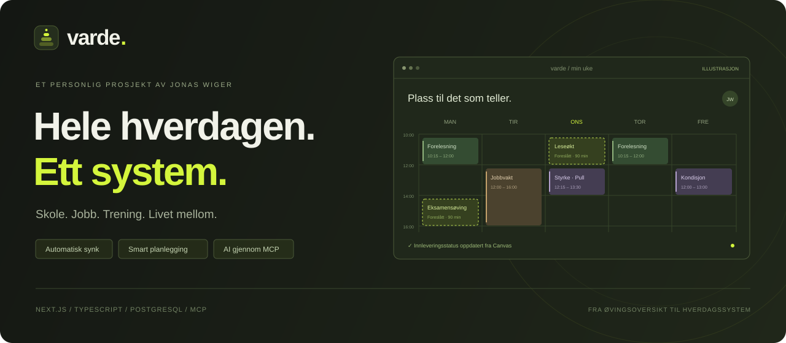
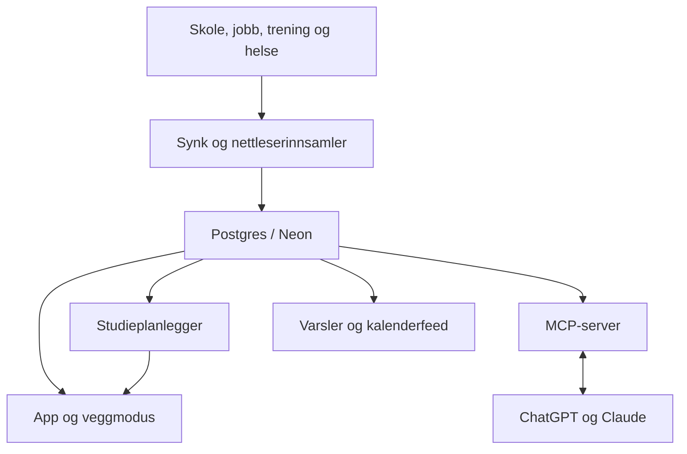

  

# Varde

**Skole, jobb, trening og livet mellom — samlet i ett personlig system.**

Det begynte som en øvingsoversikt. Jeg ville slippe å lete etter frister i Canvas, timeplaner i én app og jobbvakter i en annen. Etter hvert vokste det til Varde: en oversikt som henter inn data automatisk, finner plass til arbeidet og lar ChatGPT og Claude hjelpe med utgangspunkt i den faktiske hverdagen.

**Next.js · React · TypeScript · PostgreSQL · MCP · GitHub Actions**

*Et personlig prosjekt av [Jonas Wiger](https://github.com/JonasW04). Kalenderen i illustrasjonen bruker fiktive data.*

## Det interessante er samspillet

En kalender er nyttig. Men den blir mer nyttig når den vet hva som skal leveres, når jeg er på jobb, hvor mye tid en oppgave trenger, og hva som allerede er gjort.

| Når noe skjer … | … kan Varde følge opp |
| --- | --- |
| En ny øving dukker opp | Hente inn fristen og ta den med i planleggingen. |
| En innlevering registreres i Canvas | Oppdatere leveringsstatus automatisk når innsamleren leser siden. |
| En jobbvakt tar en ledig luke | Beregne nye forslag til leseøkter rundt avtalene. |
| En frist nærmer seg | Prioritere tidligste frist og vise hvis arbeidet ikke får plass. |
| Jeg spør AI-en om uka | Gi den kalender, gjøremål og relevante data gjennom MCP. |
| En emneside endrer struktur | Tilkalle en AI-vaktmester som kan foreslå en parserrettelse i en pull request. |

## Automatisk innhenting

Varde samler data fra verktøyene jeg allerede bruker. Kildene har ulike synkintervaller, og innstillingene viser helsestatusen til hver kilde.

| Kilde | Hva den bidrar med |
| --- | --- |
| **CalOne** | Semester, emner, timeplan og frister som finnes i kalenderen. Fagene følger med når semesteret endrer seg. |
| **Canvas og INGInious** | Øvinger, frister og leveringsstatus via en nettleserinnsamler mens jeg er innlogget. En valgfri Canvas-kalenderfeed supplerer fristene. |
| **Emnesider** | Egne parsere for støttede fag, blant annet algoritmer og statistikk. |
| **Tidsbanken** | Jobbvakter og registrerte arbeidstimer. Gir grunnlag for sammenligning mot planen og lønnsanslag med egne satser. |
| **Hevy** | Lagrede treningsrutiner, fullførte økter, arbeidssett, volum og fremgang per øvelse. Lesende integrasjon med Hevy Pro API-tilgang. |
| **Garmin** | Kondisjonsøkter, søvn, HRV, hvilepuls, stress, Body Battery, treningsbelastning og VO₂max. Uoffisiell, lesende integrasjon. |
| **Withings** | Vektmålinger og øvrige måledata gjennom OAuth. Vektdata brukes i coaching-konteksten bare når det er slått på. |

Den ordinære innhentingen bruker API-kall og parsere. Det trengs ingen språkmodell for å holde kalenderen oppdatert.

## En plan som kan endre seg

Studieplanleggeren foreslår arbeidsøkter i ledig tid før fristene. Når gjøremål, vakter eller kalenderhendelser endres, kan forslagene beregnes på nytt.

- **Tidsestimater per oppgave, fag eller kategori.** En stor øving kan fordeles over flere økter.
- **Buffer mellom avtaler.** Planen fyller ikke hvert ledige minutt.
- **Egne rammer for hverdager og helger.** Inkludert grenser for øktlengde og samlet arbeidstid per dag.
- **Tidligste frist først.** Arbeidet planlegges ferdig før fristen, med en justerbar margin.
- **Festede økter og «ikke i dag».** Jeg kan styre hva som blir stående og hvilke dager en oppgave skal unngå.
- **Synlig tidsmangel.** Hvis en oppgave ikke får plass, vises hvor mye arbeid som mangler.
- **Eksamensøving.** Øvingstid fordeles mellom fag med hensyn til eksamensdato og registrert øving.

Forslagene er adskilt fra de faktiske avtalene. En synket jobbvakt blir ikke flyttet for å få en leseøkt til å passe.

## MCP: AI som faktisk kan bruke oversikten

Varde har en egen **Model Context Protocol-server** med OAuth. Den gjør appens data og handlinger tilgjengelige for **ChatGPT, Claude og Claude Code**.

AI-en kan blant annet:

- hente og søke i kalenderen, lese gjøremål og sjekke konflikter;
- opprette og endre egne hendelser, gjentakende avtaler og gjøremål;
- reorganisere flere egne kalenderhendelser i én batch;
- forhåndsvise og validere kalenderendringer med `dry_run` før lagring;
- lese arbeidstimer, treningshistorikk og helsedata;
- lese og oppdatere coach-profil og ukesjekk;
- hente eksamensoppgaver og registrere øvingsforsøk.

Eksempler på ting jeg kan be om:

> «Hva bør jeg prioritere denne uka, og når har jeg faktisk tid til det?»
>
> «Jeg fikk en ekstra jobbvakt onsdag. Finn et nytt tidspunkt til treningen og sjekk om det krasjer med noe.»
>
> «Legg inn treningsøktene for neste uke rundt forelesninger og vakter.»
>
> «Hvordan har treningen utviklet seg, og hvilke økter ligger allerede i kalenderen?»

MCP-koblingen bruker det samme datagrunnlaget som appen. Den skiller mellom egne hendelser, synket timeplan og jobbvakter, og kan angi om en endring gjelder én forekomst eller en gjentakende serie.

## En AI-vaktmester for kildene

Innhenting fra nettsider har en svakhet: sidene endrer seg.

Derfor har Varde en **vaktmester i GitHub Actions**. Den kan kjøre ukentlig og når synken melder om en kildefeil eller et fag uten støttet kilde. Claude undersøker problemet, foreslår parserendringer og skriver tester. Resultatet blir en **pull request**.

Gjennomgang skjer manuelt som standard. Valgfri automatisk fletting krever egne innstillinger, beståtte tester uten nett og en AST-vakt som kontrollerer endringene.

Det gjør AI til et verktøy for vedlikehold, mens den vanlige synken fortsatt er deterministisk.

## Mer enn skolearbeid

### Trening, helse og coaching

Styrke, kondisjon og helse har egne visninger. Hevy-historikken gir uketrender og progresjon per øvelse, mens planlagte økter vises separat fra det som er fullført. Garmin bidrar med kondisjon og restitusjonsdata. Withings gir vektmålinger.

Coach-profilen samler mål, prioriteringer, preferanser og midlertidige begrensninger. Oppføringer kan ha utløpsdato, og en valgfri ukesjekk gir mer kontekst til videre planlegging.

### Jobb, timer og lønnsanslag

Vaktplan og registrerte timer fra Tidsbanken kan sammenlignes. Egne satser, tillegg og lønnsperioder gir et tydelig merket lønnsanslag. Endringer i vakter kan utløse pushvarsler.

### Eksamen og progresjon

Eksamensoppgaver og temaer knyttes til registrerte forsøk. Oversikten viser hva som er øvd på og hva som trenger mer arbeid, og øvingstiden kan tas med i studieplanleggeren.

### På mobilen, på veggen og i kalenderappen

- Kalender med **dag-, uke- og månedsvisning**, søk og hurtigtaster.
- Egne gjøremål med kategorier, farger, delsteg, gjentakelser og personlige frister.
- **Veggmodus** for nettbrett, med stor klokke, dagsplan og frister.
- **Kalenderabonnement via ICS** til Apple Kalender, Google Kalender og andre kalenderapper.
- **Push via ntfy og e-post**, med oppsummeringer, fristvarsler og handlingene «Ferdig» og «Utsett».
- Lyst, mørkt og systemstyrt tema.

## Slik henger det sammen

| Del | Teknologi |
| --- | --- |
| App | Next.js, React og TypeScript |
| Database | PostgreSQL på Neon; PGlite for lokal utvikling |
| AI-kobling | MCP SDK, OAuth og validerte verktøy |
| Innhenting | API-er, ICS, emneparsere og Tampermonkey |
| Vedlikehold | GitHub Actions og Claude |
| Varsler | ntfy og e-post |
| Drift | Vercel og planlagte synkjobber |

Synkede data beholder opphavet sitt. Personlige notater og egne frister kan overleve en ny synk, og flere av integrasjonene beholder siste gode resultat ved hentefeil.

---

**Bygget av [Jonas Wiger](https://github.com/JonasW04).** Dette er en offentlig prosjektpresentasjon. Kildekoden og den personlige Varde-instansen er private.
